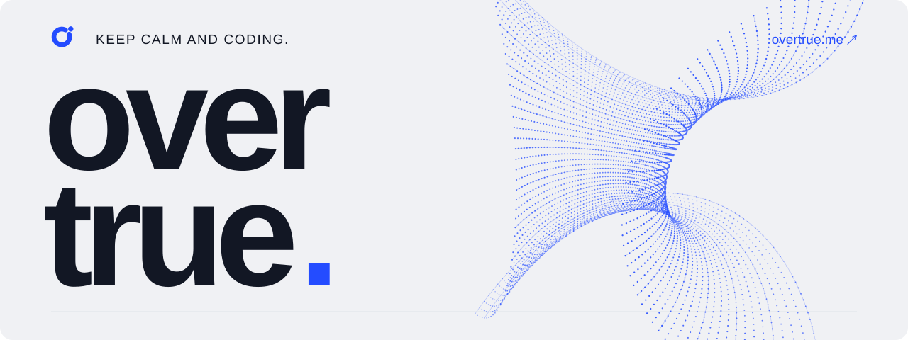

<a href="https://overtrue.me">
  <picture>
    <source media="(prefers-color-scheme: dark)" srcset="./brand/profile-dark.svg">
    <source media="(prefers-color-scheme: light)" srcset="./brand/profile-light.svg">
    
  </picture>
</a>

# Chris An · 安正超

**Open-source developer · AI dispatcher · Shenzhen, China**

You may have seen my name in Composer. I like building things that make a developer's day a little easier. These days, I'm also working on [RustFS](https://github.com/rustfs/rustfs).

写代码。做开源。保持好奇。

[Website ↗](https://overtrue.me) · [Writing](https://overtrue.me/writing/) · [Sponsor](https://github.com/sponsors/overtrue) · [Email](mailto:i@overtrue.me)

## A few things I work on

| Project | What it does |
| --- | --- |
| **[EasyWeChat](https://github.com/w7corp/easywechat)** | A PHP SDK that takes the busywork out of WeChat development. |
| **[RustFS](https://github.com/rustfs/rustfs)** | S3-compatible object storage, built in Rust. I contribute here. |
| **[Easy SMS](https://github.com/overtrue/easy-sms)** | One PHP API for sending SMS through different providers. |
| **[Pinyin](https://github.com/overtrue/pinyin)** | Chinese-to-pinyin conversion that understands context. |

[More projects ↗](https://github.com/overtrue?tab=repositories)

---

Say hello on [X](https://x.com/overtrue666), or drop me an [email](mailto:i@overtrue.me). If my work has helped you, [sponsoring it](https://github.com/sponsors/overtrue) helps me keep going.

[Brand assets](./brand/README.md)
